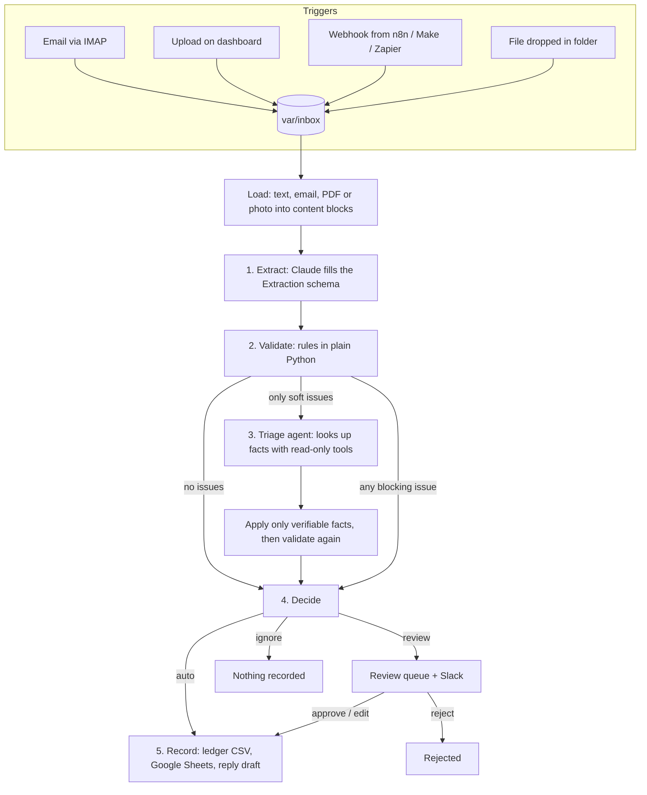

# Architecture

## One document, start to finish

Every arrow writes an event to the `events` table, so the dashboard can show the full trace for any document.

## Why the work is split this way

**Claude reads, code checks.** Language models are very good at reading a crumpled Taglish receipt and bad at being trusted with arithmetic or policy. So Claude only does the reading (step 1) and the open-ended lookup (step 3). Totals, limits, duplicates and bank details are checked in `validate.py`, where a rule either passes or it doesn't.

**Workflow first, agent only where it earns its place.** Steps 1, 2, 4 and 5 always run in the same order: that is a workflow, and it is cheap, fast and predictable. The agent in step 3 only runs when validation finds a *soft* issue (an unknown supplier name, a missing due date), because those need a few lookups in an order that depends on what it finds. In the sample set the agent runs on 1 of 13 documents.

**Two kinds of issues.**

| Severity | Examples | Who can clear it |
|---|---|---|
| block | math errors, over the limit, duplicate, changed bank account, foreign currency, low confidence, missing total | Only a person |
| soft | unknown supplier name, missing due date | The agent, by finding the fact in the café's own records |

**Propose, then verify.** The agent never approves anything. It returns a `Resolution` (for example, "this is Manila Paper Supply Co., due 2026-11-24"). `decide.apply_resolution` only accepts a supplier that exists in `suppliers.json` and a date that parses and isn't before the invoice date, and then `validate.py` runs again. If the agent is wrong or unsure, the document goes to a person, never through.

**Side effects are idempotent.** Each document's id is a hash of its bytes. Re-sending the same file is skipped, and ledgers are checked for the id before a row is written, so a retry after a crash never records an invoice twice. A *different* file with the same invoice number is caught by the duplicate rule instead.

**Drafts, not sends.** Customer replies are written to `var/out/reply_drafts/`. A person sends them. An automation that talks to customers should earn that trust first.

## Data

- `var/autopilot.db` (SQLite): `documents` (one row per document with status, extraction, issues, decision, cost) and `events` (the trace).
- `var/out/*.csv`: payables, expenses and orders ledgers. The CSV is the source of truth; Google Sheets is a mirror.
- `var/archive/`: every original file, named `<doc_id>_<filename>`, so a reviewer can always see the source and a retry can re-read it.

## Statuses

`processing` → `done` | `needs_review` | `ignored` | `failed`
`needs_review` → `done` (approved) | `rejected`
`failed` → retried up to 3 attempts, then `dead` (needs a developer)

## Model settings

- Model: `claude-opus-5-5` (change with `AUTOPILOT_MODEL`; run the evals before and after any change).
- Effort: `medium` for extraction, `high` for the agent.
- Structured outputs for extraction, `strict: true` tool schemas for the agent.
- Server-side refusal fallbacks are on (`fallbacks: "default"`), and a refusal that still comes back sends the document to a person.
- The SDK retries rate limits and server errors 4 times with backoff before the pipeline counts an attempt as failed.
